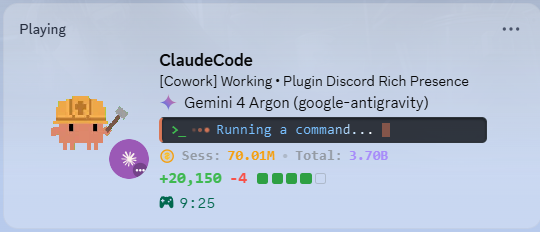

# Claude Desktop Discord Rich Presence

<p align="center">
  
</p>

<p align="center">
  <b>Live, zero-dependency Discord Rich Presence for Claude Desktop & Claude Code</b><br/>
  Automatically displays active Mode (<code>Cowork</code> / <code>Code</code>), Custom Provider Logo, Model Name, Live Terminal Thinking Box, Session & Lifetime Token Counter, GitHub Diff Bar (<code>+Added -Removed 🟩🟩🟩🟩⬜</code>), and 13 rotating animated Clawd pixel-art scenes.
</p>

---

## ✨ Features

- **🦀 13 Rotating Animated Clawd Scenes (Full-Bleed Zoomed)**: Automatically cycles through 13 pixel-art Clawd animations (*Building Blocks, Surfing Waves, Dancing Mariachi, On Fire Coding, Headphones Groove, Juggling Tasks, London Rain, Fast Typing, Rock Guitar, Gaming Time, Coffee Break, Deep Thinking, Happy Bounce*).
- **✨ Inline Vector Provider Logos (CSP-Proof)**: Automatically detects the active model and renders crisp inline SVG brand icons right before the model name (**Google Gemini**, **Anthropic Claude**, **OpenAI GPT**, **Meta AI**, **DeepSeek**, **StepFun**, **Xiaomi MiMo**).
- **🔄 Real-Time Mode & Session Detection**: Dynamically switches between `[Cowork]` and `[Code]` modes by reading live session transcripts and LevelDB UI state, showing your active session or project title.
- **💻 Animated Terminal Thinking Box (`>_ •••`)**: Displays the live thinking summary or currently executing tool inside a sleek dark terminal box with pulsing orange dots (`•••`), shimmer text, and a blinking cursor (`▋`).
- **🪙 Session & Lifetime Token Counter**: Tracks and displays both your current session token consumption (`Sess: 70.01M`) and your all-time cumulative Claude token usage (`Total: 3.70B`).
- **🟩 GitHub-Style Lines of Code Diff Bar**: Computes real-time lines added and removed (`+20,150 -4 🟩🟩🟩🟩⬜`) from your active Git repository diff and session tool calls (`Write`, `Edit`, `MultiEdit`).
- **🛡️ Discord Auto-Update Guard**: Automatically re-patches new `app-1.0.xxxx` Discord updates in the background so your Rich Presence never breaks after a Discord client update.

---

## 🚀 Quick Installation (Windows)

1. Clone or download this repository:
   ```bash
   git clone https://github.com/HaydernCenterpoint/Claude-Desktop-Discord-Rich-Presence.git
   cd Claude-Desktop-Discord-Rich-Presence
   ```
2. Double-click **`Install-AutoStart-When-Claude-Opens.bat`** (or run `node install-claude-mcp.js`).
3. Press **`Ctrl + R`** inside your Discord Desktop window to reload and activate the Rich Presence immediately.

---

## 📁 Project Structure

| File | Description |
| :--- | :--- |
| `RPCIPC.patched.js` | Core Discord `RPCIPC` hook containing the multi-scene Clawd rotator, inline SVG provider logos, terminal thinking box, token counter, and GitHub diff bar. |
| `discord-update-guard.js` | Background guard that automatically patches newly downloaded Discord `app-1.0.xxxx` versions. |
| `discord-ipc.js` | Standalone zero-dependency Windows Named Pipe (`\\?\pipe\discord-ipc-0`) client. |
| `mcp-server.js` | Model Context Protocol (MCP) server for manual or agent-driven status updates inside Claude Desktop. |
| `dashboard.js` | Local Web Dashboard (`http://127.0.0.1:3847`) with live preview for customizing templates and settings. |
| `CustomActivityRPC.plugin.js` | Standalone BetterDiscord plugin version. |
| `config.json` | Configuration file stored in `%APPDATA%\discord-rpc-plugin\config.json`. |

---

## 🙏 Credits & Artwork Sources

- **ClawdMoji** by [@afspies](https://github.com/afspies/ClawdMoji) — Animated pixel-art Clawd variants.
- **Clawd on Desk** by [@rullerzhou-afk](https://github.com/rullerzhou-afk/clawd-on-desk) — Animated Clawd desktop pet states.
- **Clawd Emotes Skill** by [@xixicc186](https://github.com/xixicc186/clawd-emotes-skill) — Pixel-crab hobby & daily-life emotes.
- **Claude Code Discord Status** by [@BrunoJurkovic](https://github.com/BrunoJurkovic/claude-code-discord-status) — Discord Application ID & status badge assets.

---

## 📄 License

MIT License © [HaydernCenterpoint](https://github.com/HaydernCenterpoint)
